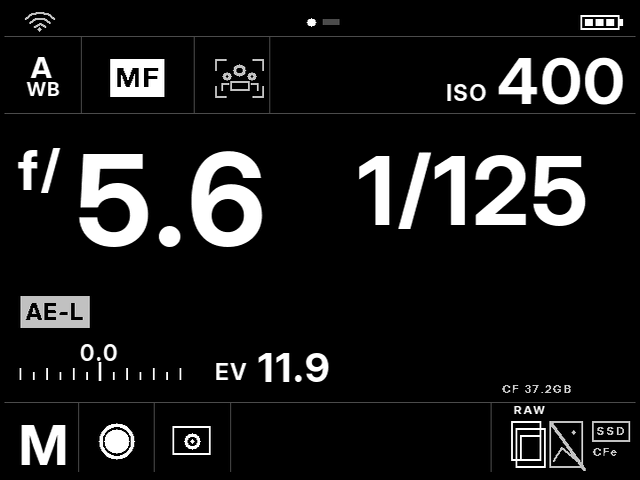

# CamDesk for Magic Lantern

[简体中文](README.md) · English

A photography-focused interface and shooting toolkit for **Magic Lantern**, with a Hasselblad-inspired monochrome status screen, large exposure readouts and Chinese menu localization.

The project is intended for Magic Lantern cameras. **EOS 50D is currently the only development and camera-test model. Other models are unverified and require porting, a model-specific build and camera testing.** The downloadable binary in this release is specifically for **Canon EOS 50D running Canon firmware 1.0.9** (`50D.109`).

*Host-rendered preview using the packaged fonts and drawing code. Values are examples, not camera measurements. The central gray region in the LiveView preview represents the camera image.*

## Features

- A status-first landing screen with reference-style cells, large aperture/shutter readouts, white balance, AF/MF, ISO, exposure compensation and EV.
- Current camera properties for white balance, photo/LiveView color temperature, compensation, drive, metering, storage and battery categories.
- A four-field LiveView bar: shooting mode, shutter, aperture and ISO. Unreadable aperture displays `M.AP`.
- A dial turn opens the full Magic Lantern menu; the status screen is read-only.
- Chinese menu localization: 2,585 entries and six Chinese font sizes, plus an antialiased bold instrument face.
- Finite interval shooting through Magic Lantern's native intervalometer.

Wi-Fi, subject recognition, AE-L, second-media, SSD and CFe symbols are gray visual placeholders. They do not report activation or add those capabilities. Battery percentage is not fabricated. EV is `log2(N²/t)` from aperture and shutter, independent of ISO; missing values and Bulb show `--`.

## Compatibility and status

| Item | Status |
| --- | --- |
| Project scope | Magic Lantern interface/toolkit; other-camera ports welcome |
| Current binary | EOS 50D + Canon firmware **1.0.9**, target **50D.109** |
| Installation prerequisite | Magic Lantern already installed; a working bootable CF card |
| Other ML-supported cameras | Unverified; adapt and rebuild for the exact camera/firmware |
| Camera experience | Earlier versions exercised on a 50D; user feedback drove this revision |
| Latest 0.4.2-hui | ARM build, host tests and card readback passed; camera regression pending |

Do not copy this 50D binary, symbol file or module combination to another camera. Magic Lantern support alone does not make camera-specific binaries interchangeable. This is a community project, unaffiliated with Canon, Hasselblad or the upstream Magic Lantern maintainers.

## Download and use

Use the **card ZIP** from the GitHub release and read [installation instructions](docs/release/INSTALL.en.md). Publish/download the matching **source ZIP** and `SHA256SUMS.txt` alongside it. No Canon firmware updater or Magic Lantern first-install `.FIR` is included.

[Build guide](docs/release/BUILD.md) · [Release notes](docs/release/RELEASE.md) · [Licenses and credits](THIRD_PARTY_NOTICES.md)

## License

CamDesk-authored code is GPL-2.0-or-later. Upstream and vendored files retain their original licenses. Font licenses are included: Inter (SIL OFL 1.1) and WenQuanYi Micro Hei (see its bundled license). See [LICENSE](LICENSE) and [third-party notices](THIRD_PARTY_NOTICES.md).
