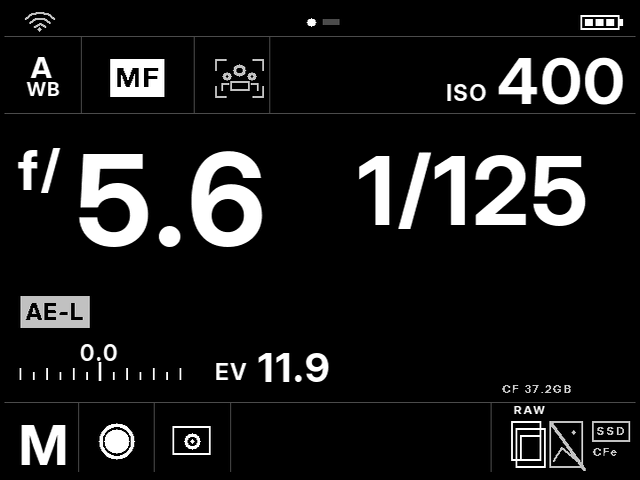

# CamDesk for Magic Lantern

简体中文 · [English](README.en.md)

基于 **Magic Lantern（魔灯）** 的相机界面与拍摄工具：哈苏风格黑白参数屏、大字号曝光读数、中文菜单与有限次数间隔拍摄。

项目面向支持魔灯的相机。**目前只在 EOS 50D 上开展开发与实机测试；其他机型尚未验证，需要适配、按机型编译并实测。** 本次提供的成品专为 **Canon EOS 50D／佳能固件 1.0.9** 编译，目标平台为 `50D.109`。

*预览来自实际绘制代码与打包字库，数值为演示。取景预览中的灰色区域代表机身画面。*

## 功能

- 打开魔灯先显示参数主屏：参考图分格、大光圈／快门、白平衡、AF/MF、ISO、曝光补偿与EV。
- 接入相机当前白平衡、拍照／实时取景色温、补偿、驱动、测光、卡余量和电池档位。
- 实时取景底栏保留模式、快门、光圈、ISO四项；光圈不可读时显示 `M.AP`。
- 转动拨轮进入完整魔灯菜单；参数首屏为只读显示。
- 中文菜单词库2,585条，六种中文字号，参数采用抗锯齿粗体字库。
- 调用魔灯原生间隔拍摄引擎，支持间隔、延时、有限次数和停止。

Wi-Fi、主体识别、AE-L、第二存储位、SSD和CFe为灰色装饰图标，不代表这些功能已启用或新增硬件能力。电池显示真实档位，不虚构百分比。EV按当前光圈、快门计算 `log2(N²/t)`，不含ISO；参数缺失或B门时显示 `--`。

## 适用范围与验证状态

| 项目 | 状态 |
| --- | --- |
| 项目定位 | 面向Magic Lantern的界面与工具，欢迎其他机型移植 |
| 本次成品 | EOS 50D＋佳能固件 **1.0.9**，平台 **50D.109** |
| 安装前提 | 已安装魔灯，CF卡已能正常启动魔灯 |
| 其他支持魔灯的机型 | 尚未验证，需适配并按对应机型／固件编译 |
| 实机情况 | 已在50D使用早期版本，并据实拍反馈修订 |
| 最新0.4.2-hui | ARM编译、电脑端测试和写卡读回通过；实机回归待完成 |

不同机型的核心、符号表和模块不能混用；支持魔灯不代表可以通用同一套二进制文件。本项目为社区开发，与佳能、哈苏及魔灯上游维护者无隶属关系。

## 下载与使用

从GitHub Release下载 **card成品包**，按[中文安装说明](docs/release/INSTALL.zh.md)操作。发布时应同时附上对应的 **source源码包** 和 `SHA256SUMS.txt`。包内不含佳能固件升级器或魔灯首次安装 `.FIR`。

[构建说明](docs/release/BUILD.md) · [中英更新日志](docs/release/RELEASE.md) · [来源与授权](THIRD_PARTY_NOTICES.md)

## 开源许可

CamDesk自编代码采用GPL-2.0-or-later；上游与第三方文件保留各自许可。随包保留Inter字体的SIL OFL 1.1许可及文泉驿微米黑授权。详见 [LICENSE](LICENSE) 和[第三方声明](THIRD_PARTY_NOTICES.md)。
